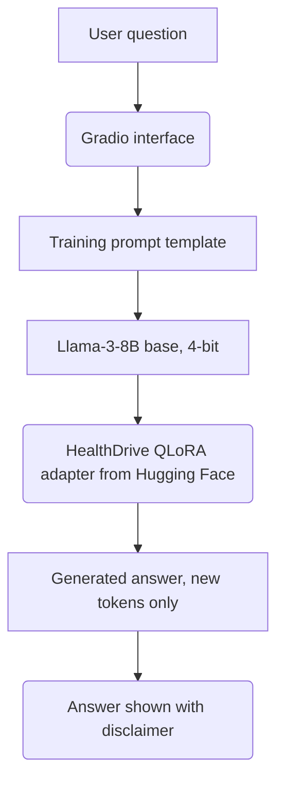

# HealthDrive Medical Triage Chatbot

[](https://colab.research.google.com/drive/174R2oJaXsPs3xugptWf8XDu8X6A-kCC6)
[](https://huggingface.co/AgbajeCity/healthdrive-triage-llama3-8b-lora)

This repository holds a medical question-answering assistant built for HealthDrive, a rural health service. It is a Llama-3-8B model fine-tuned with QLoRA on medical flashcards. The fine-tuned adapter, its training log and its evaluation files are published on Hugging Face at [AgbajeCity/healthdrive-triage-llama3-8b-lora](https://huggingface.co/AgbajeCity/healthdrive-triage-llama3-8b-lora).

The model is a research prototype for education. It does not diagnose, prescribe or replace a clinician.

## Results on unseen questions

I scored the base model and the fine-tuned model on the same 200 held-out questions. None of them appear in the training set. Both models used greedy decoding with up to 64 new tokens.

| Metric | Base Llama-3-8B (4-bit) | Fine-tuned (QLoRA) |
| --- | --- | --- |
| BLEU (0 to 100) | 16.30 | **40.59** |
| ROUGE-1 (0 to 1) | 0.446 | **0.681** |
| ROUGE-L (0 to 1) | 0.394 | **0.626** |

BLEU rose about 2.5 times. ROUGE-L, which rewards matching the reference answer's wording in order, rose from 0.394 to 0.626. These metrics measure overlap with the reference answers. They do not measure clinical correctness, so I also read the answers one by one (see below).


All 200 questions, reference answers and both models' answers are in [heldout_predictions.csv](https://huggingface.co/AgbajeCity/healthdrive-triage-llama3-8b-lora/blob/main/evaluation/heldout_predictions.csv). The raw numbers are in [metrics.json](https://huggingface.co/AgbajeCity/healthdrive-triage-llama3-8b-lora/blob/main/evaluation/metrics.json).

## Data

The model was trained on [`medalpaca/medical_meadow_medical_flashcards`](https://huggingface.co/datasets/medalpaca/medical_meadow_medical_flashcards). I removed 400 rows with empty questions or answers, leaving 33,547. Of those, rows 0 to 1,999 were used for training and rows 2,000 to 2,199 were held back as the test set. As a leakage check, the notebook counts how many test questions also appear in the training set. The count is 0.

Every example uses one template, and `app.py` uses the same one:

```
Below is a medical question. Write a clinical and accurate answer.

### Question:
{question}

### Answer:
{answer}
```

## Training

| Setting | Value |
| --- | --- |
| Base model | `unsloth/llama-3-8b-bnb-4bit` (4-bit, bitsandbytes) |
| Method | QLoRA via Unsloth and TRL `SFTTrainer` |
| LoRA rank and alpha | 16 and 16, on q, k, v, o, gate, up and down projections |
| Learning rate | 2e-4, linear schedule |
| Batch | 1 per device, gradient accumulation 8 (effective 8) |
| Optimiser | adamw_8bit, weight decay 0.01 |
| Data and steps | 2,000 examples, 1 epoch, 250 steps |
| Hardware | Google Colab T4 GPU |
| Loss | mean 0.75 over the run; final logged value 0.65 |


## Examples from the held-out set

These are real outputs copied from `heldout_predictions.csv`.

**Question:** What is Amiodarone, and what are the potential thyroid-related side effects of taking it?

* Reference: Amiodarone is a class III antiarrhythmic medication that can cause both hyper- and hypothyroidism as potential side effects.
* Base model: "Amiodarone is a medication used to treat abnormal heart rhythms. It is a medication that is used to treat abnormal heart rhythms..." (repeats itself and never names the thyroid effects)
* Fine-tuned: "Amiodarone is an antiarrhythmic medication that can cause thyroid-related side effects such as hyperthyroidism or hypothyroidism."

**Question:** What combination of medications is used for the treatment of cryptococcal meningitis?

* Reference: Amphotericin B and Flucytosine.
* Base model: "amphotericin B and flucytosine." (correct)
* Fine-tuned: "a combination of fluconazole and flucytosine." (wrong drug)

The second example shows why the scores alone are not enough. The fine-tuned model writes in the style of the reference answers far more often, but it can still state a wrong fact with confidence.

## Limitations

* English only, and trained on short flashcard answers, not on real patient conversations or triage records.
* BLEU and ROUGE reward similar wording, not safe or correct advice.
* The test set comes from the same dataset as the training set, so these scores say little about questions phrased the way patients phrase them.
* Not reviewed by clinicians. Do not use it for patient care.

## Run it

**Colab:** open the notebook from the badge above, choose a T4 GPU, add your own Hugging Face token as a Colab secret named `HF_TOKEN`, then run all cells. The notebook retrains the adapter and repeats the evaluation.

**Local or server with a GPU:**

```bash
pip install -r requirements.txt
python app.py
```

`app.py` downloads the adapter from Hugging Face and opens a Gradio interface. To point it at a different adapter, set `HEALTHDRIVE_ADAPTER`.

## Architecture



## Repository structure

```
HealthDrive-Triage-Chatbot/
├── Notebook/      training and evaluation notebook
├── Data/          medical_flashcards_dataset.csv
├── app.py         Gradio app that loads the published adapter
├── Dockerfile
├── requirements.txt
├── LICENSE        MIT
└── README.md
```

The code is MIT licensed. Use of the base model is subject to the Meta Llama 3 Community License.
